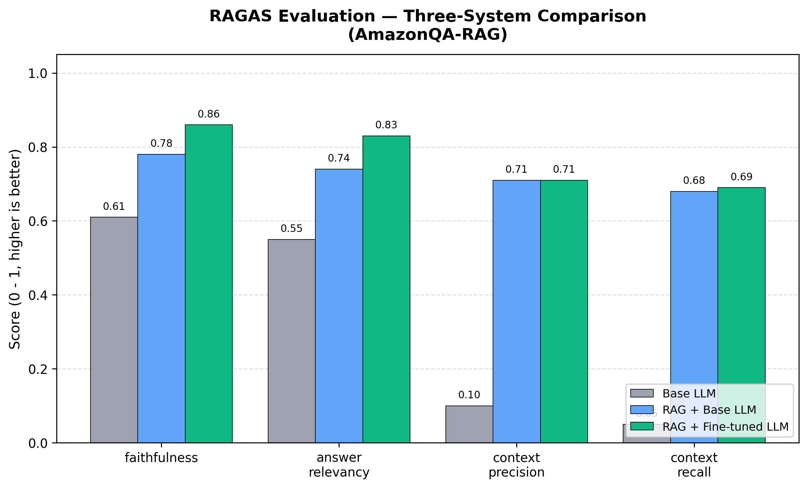

# AmazonQA-RAG

## Abstract
AmazonQA-RAG is an end-to-end retrieval-augmented question answering project built on Amazon product Q&A data. The system combines QLoRA fine-tuning of an instruction LLM, a FAISS-backed retrieval pipeline, RAGAS-based evaluation, and a Streamlit demo into one reproducible workflow. The project is designed to answer customer-style product questions more faithfully than a base LLM while staying practical for Colab T4-class hardware. It is positioned as an interview-ready applied ML project with strong emphasis on evaluation, ablation, and deployment.

## Tech Stack
- Python
- PyTorch
- Hugging Face Transformers / Datasets / PEFT
- TRL + BitsAndBytes (QLoRA)
- LangChain
- FAISS
- sentence-transformers
- RAGAS
- Streamlit

## Project Highlights
- Fine-tuned an instruction LLM on Amazon Q&A data using QLoRA (4-bit NF4 + LoRA adapters) to fit consumer/free-tier GPU constraints.
- Built a retrieval-augmented pipeline using sentence-transformer embeddings, FAISS vector search, and LangChain retrieval chains.
- Benchmarked `Base LLM`, `RAG + Base LLM`, and `RAG + Fine-tuned LLM` using RAGAS metrics including faithfulness, answer relevancy, context precision, and context recall.
- Delivered an interactive Streamlit demo with model switching, retrieved context inspection, session history, and optional per-query RAGAS scoring.

## Repository Layout
The current repository keeps the phase modules separate and stable for the notebooks/app:

```text
amazonqa-rag/
  app.py
  configs/
    __init__.py
    config.py
  data/
  evaluation/
    __init__.py
    generators.py
    ragas_eval.py
    test_set.py
    visualize.py
  notebooks/
  results/
  scripts/
  src/
    __init__.py
    finetune.py
    llm_loader.py
    rag_pipeline.py
  tests/
  requirements.txt
  pyproject.toml
  LICENSE
  README.md
```

## Phase Overview
1. **Phase 1 - Fine-tuning**: QLoRA training on `embedding-data/Amazon-QA`.
2. **Phase 2 - RAG**: FAISS-based retrieval over an Amazon QA corpus.
3. **Phase 3 - Evaluation**: RAGAS comparison across three systems.
4. **Phase 4 - Demo**: Streamlit app for interactive querying.
5. **Final Phase - Cleanup / Testing / Documentation**: repo polish, tests, and resume material.

## How To Run

> Important: Phase 1 QLoRA training requires a CUDA GPU (recommended: Colab T4). On CPU-only machines, training will fail with a BitsAndBytes quantization error.

### 1. Create a virtual environment
```bash
python -m venv .venv
source .venv/bin/activate
```

On Windows PowerShell:

```powershell
python -m venv .venv
.venv\Scripts\Activate.ps1
```

### 2. Install dependencies
```bash
pip install -r requirements.txt
```

Windows-safe alternative (avoids interpreter confusion):

```powershell
.\.venv\Scripts\python.exe -m pip install --upgrade pip
.\.venv\Scripts\python.exe -m pip install -r requirements.txt
```

### 3. Fine-tune the model (optional if artifacts already exist)
```bash
python -m src.finetune
```

If you do not have a local GPU, run Phase 1 in Colab using `notebooks/01_qlora_finetune.ipynb`.

### 4. Build the RAG index
Use `notebooks/02_build_rag.ipynb`, or call the Phase 2 functions programmatically.

Quick CLI-style build:

```powershell
.\.venv\Scripts\python.exe -c "from configs.config import get_default_config; from src.rag_pipeline import build_corpus_from_hf, load_documents, chunk_documents, build_vector_store; cfg=get_default_config(); build_corpus_from_hf(cfg, output_format='csv', overwrite=False); docs=load_documents(cfg); chunks=chunk_documents(docs, cfg); build_vector_store(chunks, cfg); print('Done: corpus + index created')"
```

### 5. Run RAGAS evaluation
```bash
python -m evaluation.test_set --n_samples 100
python -m evaluation.ragas_eval --system all --n_samples 100
```

Quick smoke test:

```bash
python -m evaluation.ragas_eval --system all --smoke-test
```

### 6. Launch the demo
```bash
streamlit run app.py
```

## Testing
The repository includes a lightweight pytest suite focused on code-path and interface validation.

```bash
pip install -r requirements.txt
python -m pytest -q
```

The tests avoid loading full production models and instead use toy/stub objects where appropriate, so they can run quickly in a normal development environment.

## RAGAS Evaluation
The main comparison plot from Phase 3 is saved to `results/ragas_comparison.png`.



See `results/ragas_summary.csv` and `evaluation/README_RAGAS_SNIPPET.md` for the full benchmarking narrative and paste-ready reporting text.

## Demo
The project ships with a Streamlit app in `app.py` that exposes all three model variants:
- `Base LLM`
- `RAG + Base LLM`
- `RAG + Fine-tuned LLM`

The app lets you ask Amazon-style product questions, inspect retrieved context chunks, preserve session chat history, and optionally compute lightweight per-query RAGAS diagnostics.

Run locally:

```bash
streamlit run app.py
```

For deployment notes, see `DEMO_README_SNIPPET.md`.

## How This Relates To Amazon ML
- Focuses on customer-style product question answering, closely aligned with real-world support, catalog, and shopping-assistant use cases.
- Demonstrates pragmatic model adaptation under hardware constraints using QLoRA rather than assuming expensive training infrastructure.
- Emphasizes retrieval grounding and evaluation culture: not just building a chatbot, but measuring hallucination resistance and retrieval quality systematically.
- Reflects an Amazon-style bias toward scalable, testable systems where user trust depends on correctness and traceable evidence.

## Resume / SOP Summary
See the final section below for resume bullets and a project summary you can reuse directly.

### Resume Bullets
- Built an end-to-end Amazon product Q&A assistant by fine-tuning an instruction LLM with QLoRA and grounding answers with a FAISS-based RAG pipeline.
- Designed a three-way ablation study across Base, RAG + Base, and RAG + Fine-tuned systems, and quantified answer quality using RAGAS metrics such as faithfulness and answer relevancy.
- Engineered a reproducible ML workflow spanning training, retrieval, evaluation, and deployment, with cached artifacts, modular Python code, and automated notebook/demo support.
- Delivered a Streamlit demo with model switching, retrieved-context inspection, session history, and optional per-query RAGAS diagnostics for interactive analysis.

### Project Summary (SOP / LinkedIn)
I built AmazonQA-RAG to study how far a compact, evaluation-driven LLM system could go on realistic customer-style product questions under limited hardware. The project combines QLoRA fine-tuning on Amazon QA data, a FAISS-based retrieval pipeline using sentence-transformer embeddings, and a structured RAGAS evaluation comparing a base model, a retrieval-augmented base model, and a retrieval-augmented fine-tuned model. This helped me move beyond qualitative demos and measure faithfulness, answer relevancy, and retrieval quality in a reproducible way. I also wrapped the system in a Streamlit app so the behavior is inspectable end-to-end. The biggest lesson for me was that good ML systems are not just about model choice; they depend equally on data formatting, retrieval design, careful evaluation, and deployable engineering.

## Final Sanity Checklist
- Create and activate a virtual environment.
- Install dependencies with `pip install -r requirements.txt`.
- Prepare artifacts: either run fine-tuning or place the saved LoRA adapter in `artifacts/lora_adapter/`.
- Build the FAISS index via Phase 2.
- Generate the held-out evaluation set with `python -m evaluation.test_set --n_samples 100`.
- Run Phase 3 evaluation with `python -m evaluation.ragas_eval --system all --n_samples 100`.
- Launch the app with `streamlit run app.py`.
- Push the repository, plots, and result CSVs to GitHub or Hugging Face Spaces.

## License
MIT License. See `LICENSE`.
