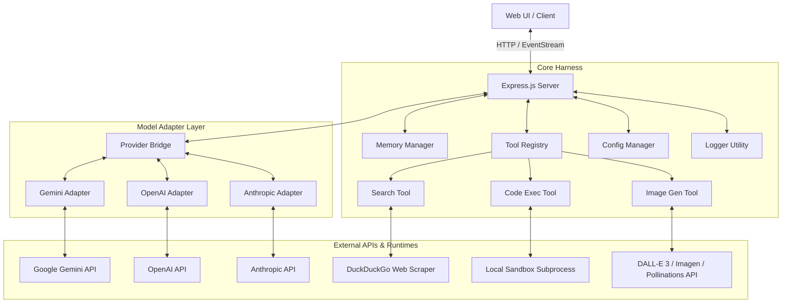

# Conversational Agent Harness - Architecture & Plan

This plan details the design, architecture, and file structure for building a custom ChatGPT-style conversational agent harness. It addresses memory, configurations, tools (search, code-exec), structured logging, multi-model providers, and a modern, high-fidelity user interface.

---

## 1. Architecture Diagram

The harness uses a **Provider-Adapter Pattern** to isolate model differences and a **Service-Based Core** to manage memory, tools, and configurations.



---

## 2. File Structure Proposal

We propose a Node.js + ES Modules layout. It is lightweight, maps well to your current development preferences, and supports standard web frontends.

```
chatgpt/
├── .env                       # API keys (GEMINI_API_KEY, OPENAI_API_KEY, ANTHROPIC_API_KEY)
├── .gitignore                 # Exclude node_modules, .env, logs, and temp execution files
├── package.json               # Dependencies and test script
├── PLAN.md                    # This plan & architectural spec
├── config/
│   ├── config.json            # Global settings (default model, tool settings, temperature)
│   └── system_prompts/        # Text files containing system prompts
│       ├── default.txt        # Default assistant behavior
│       ├── developer.txt      # Specialized for writing code and debugging
│       └── creative.txt       # For creative writing and brainstorming
├── src/
│   ├── index.js               # Entry point (Express.js server and routes)
│   ├── providers/             # Adapters for swapping LLM providers
│   │   ├── index.js           # Bridge/factory interface
│   │   ├── gemini.js          # Google Gemini API adapter
│   │   ├── openai.js          # OpenAI API adapter
│   │   └── anthropic.js       # Anthropic API adapter
│   ├── memory/                # Conversation history & context window control
│   │   └── index.js           # Handles serialization and memory consolidation
│   ├── tools/                 # Tool definitions and execution wrappers
│   │   ├── index.js           # Tool schema registry and orchestrator
│   │   ├── search.js          # Web search tool (DuckDuckGo integration)
│   │   ├── codeExec.js        # Local JavaScript & Python execution engine
│   │   └── imageGen.js        # Image generation tool (DALL-E 3/Imagen/Pollinations)
│   └── utils/
│       └── logger.js          # Console & file-based logger (rotating logs)
├── public/                    # High-fidelity web interface
│   ├── index.html             # Glassmorphism HTML layout
│   ├── style.css              # Custom variables, dark-mode styling, animations
│   └── app.js                 # EventSource stream connection and UI interactions
└── tests/                     # Unit and integration tests
    ├── memory.test.js         # Verifies conversation history management
    ├── tools.test.js          # Tests search parser and code execution sandbox
    └── providers.test.js      # Verifies model provider interfaces (with mocks)
```

---

## 3. Component Details & Design Decisions

### A. Conversation Memory (`src/memory/index.js`)
- **Structure**: Each conversation will have an identifier. History is saved as a structured list of messages: `[{ role: 'user' | 'assistant' | 'system' | 'tool', content: string, tool_calls?: Array, name?: string }]`.
- **Persistence**: History is saved as JSON files in a dedicated `.data/conversations/` directory to persist sessions across server restarts.
- **Context Management**: Implement a **Sliding Window + Summarization** strategy. If context length exceeds 80% of the active model's window, the oldest messages (excluding the system prompt) will be summarized and consolidated into a single summary block.

### B. Swappable Model Providers (`src/providers/`)
- A unified interface ensures swapping models does not break core logic.
- **Provider Interface**:
  ```javascript
  class BaseProvider {
    /**
     * @param {Array} messages - Combined conversation history + system prompt
     * @param {Array} tools - Array of tool definitions
     * @param {Object} options - Temperature, maxTokens, etc.
     */
    async generate(messages, tools, options) { throw new Error('Not implemented'); }
  }
  ```
- Adding a new model provider only requires implementing this interface and registering it in `src/providers/index.js`.

### C. Tools Layer (`src/tools/`)
- Models supporting function calling (Gemini, OpenAI, Anthropic) will receive tool declarations in their native formats.
- **Search Tool (`search`)**: Utilizes a lightweight, dependency-free web search scraping module (or api wrapper) querying DuckDuckGo to obtain relevant snippet results.
- **Code Execution Tool (`codeExec`)**:
  - Accepts a `language` ('javascript' | 'python') and a string of `code`.
  - Spawns a subprocess with restricted execution bounds (time limit of 5 seconds, memory limits, environment isolation).
  - Captures and returns `stdout` and `stderr` to the model.
- **Image Generation Tool (`imageGen`)**:
  - Accepts a `prompt` (description of the image).
  - Uses OpenAI DALL-E 3 (if key is set) or Gemini Imagen 3 (if key is set) or falls back to a high-quality free API (e.g. Pollinations AI) to generate visually stunning images dynamically.
  - Returns the URL of the generated image.

### D. System Prompts & Configurations (`config/`)
- Easily swap system roles by modifying the active file.
- Prompts are stored in `.txt` files under `config/system_prompts/` and loaded dynamically.

### E. Structured Logger (`src/utils/logger.js`)
- Records server requests, API interactions, tool invocations, and errors.
- Output formatting: Terminal color-coded logs for developer convenience and JSON files for machine parsing.

### F. High-Fidelity UI (`public/`)
- Google Gemini-style minimalist layout using native HTML/CSS/JS.
- **Design Details**:
  - **Color Theme**: Obsidian backgrounds (`#131314` and `#0e0e11`) with rounded card elements (`#1e1f20`).
  - **Collapsible Sidebar**: A hamburger button toggles the sidebar's visible state. When collapsed, the sidebar hides completely to maximize reading and workspace area.
  - **Welcome Header**: Dynamic text gradient header ("Hello, Sandbox") fading from deep blue to lavender and magenta, combined with horizontal suggestion chips.
  - **Flat Chat Flow**: User messages are rendered in neat dark pill bubbles (`#1e1f20`), while Assistant messages are rendered flat (no bubble borders/backgrounds) with styled sparkle icons and spacious line-height.
  - **Minimalist Tool Chips**: Tool execution flows are rendered as minimalist outline chips with inline status indicators. Collapsible pre-blocks are kept to show raw stderr/stdout logs.
  - **Input Pill**: Wide centered input container (`border-radius: 32px`, background `#1e1f20`) with text area and nested button rows.

---

## 4. Verification Plan

### Automated Tests (`tests/`)
We will use a lightweight test runner (native Node.js test runner `node:test` and `node:assert` to minimize dependencies).
- Run: `npm test`
- Scope:
  - Memory persistence and truncation.
  - Subprocess safety and output formatting of `codeExec`.
  - Tool calling JSON format validators.

### Manual Verification
- Testing responsiveness of the UI across window sizes.
- Real-time swapping of models during a conversation to prove history is maintained.
- Running a piece of Python or JavaScript code via the chat interface and observing output blocks.

---

## 5. Next Steps

1. Wait for user review and approval of the Gemini UI redesign plan.
2. Update [index.html](file:///c:/Users/kvais/OneDrive/Desktop/Projects%20folder/chatgpt/public/index.html) to include hamburger button triggers, update welcome greetings, and structure sidebar wrappers.
3. Overhaul [style.css](file:///c:/Users/kvais/OneDrive/Desktop/Projects%20folder/chatgpt/public/style.css) with Gemini color tokens, input pill styling, collapsed transition properties, and flat response elements.
4. Update [app.js](file:///c:/Users/kvais/OneDrive/Desktop/Projects%20folder/chatgpt/public/app.js) to support sidebar toggling, copy buttons for code blocks, and bubble formatting.
5. Manually verify responsiveness and visuals.
